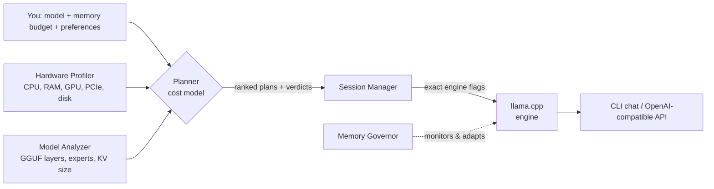

<div align="center">

# RAMLLM

**Run bigger models on smaller machines**

A memory-budgeted, hardware-adaptive manager for local LLM inference. Tell it how much VRAM, RAM, and patience you have. It plans how to fit the model, tells you honestly how fast it will run, and enforces the budget while it runs.

<!-- TODO(author): add a logo or banner image: docs/assets/banner.png -->

[](LICENSE)
[](pyproject.toml)
[](docs/backend-notes.md)
[](docs/architecture.md)

<!-- TODO(author): replace the old static "62 passing" test badge with a live CI badge.
     Check the workflow filename in .github/workflows/ and use:
     [](https://github.com/Mayank3613/RAMLLM/actions)
-->

[Quickstart](#quickstart) · [What can my machine run?](#what-can-my-machine-run) · [Concepts](#concepts-explained) · [Commands](#cli-command-reference) · [API](#openai-compatible-http-api) · [FAQ](#faq--troubleshooting) · [Contributing](#contributing)

</div>

---

## Table of Contents

- [TL;DR](#tldr)
- [Demo](#demo)
- [The Problem](#the-problem)
- [The RAMLLM Solution](#the-ramllm-solution)
- [How It Works (in 60 seconds)](#how-it-works-in-60-seconds)
- [Key Features](#key-features)
- [Who Is It For?](#who-is-it-for)
- [What Can My Machine Run?](#what-can-my-machine-run)
- [Prerequisites & Installation](#prerequisites--installation)
- [Quickstart](#quickstart)
- [Concepts Explained](#concepts-explained)
- [CLI Command Reference](#cli-command-reference)
- [Reading a Plan](#reading-a-plan)
- [Execution Strategies](#execution-strategies)
- [Memory Governor](#memory-governor)
- [Architecture & Cost Model](#architecture--cost-model)
- [OpenAI-Compatible HTTP API](#openai-compatible-http-api)
- [Integrations & Recipes](#integrations--recipes)
- [Configuration & File Locations](#configuration--file-locations)
- [Accuracy & Benchmarks](#accuracy--benchmarks)
- [Compatibility](#compatibility)
- [RAMLLM vs. Running llama.cpp Directly](#ramllm-vs-running-llamacpp-directly)
- [FAQ & Troubleshooting](#faq--troubleshooting)
- [Limitations & Honest Notes](#limitations--honest-notes)
- [Privacy & Security](#privacy--security)
- [Project Structure](#project-structure)
- [Development & Testing](#development--testing)

- [Contributing](#contributing)
- [Acknowledgements](#acknowledgements)
- [License](#license)

---

## TL;DR

**What it is:** a planning and supervision layer that sits on top of inference engines (starting with [llama.cpp](https://github.com/ggml-org/llama.cpp)). It does **not** replace them.

**What it does:** measures your hardware, reads a GGUF model's structure, searches for the best way to place the model across GPU memory → system RAM → disk, predicts speed *before* you wait on a download or a load, then launches the engine with the right settings and watches memory while it runs.

**What it promises:** making larger models reachable on constrained hardware, with an honest estimate of speed. It does **not** claim every model runs well in every memory budget. When a model is too big or too slow, it says so and suggests alternatives.

**What it gives you:** a CLI (`plan`, `run`, `serve`, `recommend`, `bench`, `models`, …) and an OpenAI-compatible local API with live memory metrics.

**Works offline** once your models are downloaded. **No telemetry.**

```bash
$ ramllm plan mistral-7b.Q4_K_M.gguf --vram 6GB --ram 16GB --context 8k

#1  full GPU        4.8 GB VRAM    ~42–51 tok/s   COMFORTABLE
    (bottleneck: GPU memory bandwidth)

#2  partial GPU     3.1 GB VRAM    ~18–24 tok/s   COMFORTABLE

#3  CPU only        0.0 GB VRAM    ~8–11 tok/s    CONSTRAINED
```

*(Numbers are illustrative; yours depend on your hardware.)*

---

## Demo

<!-- TODO(author): record a 30–60 s terminal demo (asciinema or a GIF) showing:
     `ramllm doctor` → `ramllm plan ...` → `ramllm run ...` → `ramllm serve ...`.
     Save it as docs/assets/demo.gif and uncomment:
     
-->

*A short terminal recording will go here.*

---

## The Problem

Local inference tools make open-weight LLMs accessible, but **memory remains a brutal barrier:**

- **Catastrophic OOM Crashes:** Models requiring tens of gigabytes fail immediately on 8 GB or 16 GB machines.
- **OS Thrashing & Freezes:** Uncoordinated virtual memory swapping locks up the entire operating system.
- **Trial-and-Error Guesswork:** Users guess how many layers to offload (`-ngl`), which quantization fits, whether KV quantization is safe, or whether Mixture-of-Experts (MoE) CPU offloading is viable.
- **Dishonest Predictions:** Existing tools launch configurations that drop to 0.05 tokens/sec without prior warning.

Memory-mapping, quantization, and GPU offloading help, but on their own they don't guarantee a strict memory budget, and they leave the *"which combination should I use?"* question to you.

---

## The RAMLLM Solution

RAMLLM acts as a **memory-budgeted, hardware-adaptive inference manager:**

1. **Profiles Hardware:** Measures CPU SIMD instructions, RAM throughput, GPU VRAM & PCIe/unified-memory bandwidth, and storage read rates.
2. **Analyzes GGUF Topology:** Inspects GGUF metadata, tensor layouts, dense vs. MoE expert distribution, and KV-cache footprints *without loading weights into memory*.
3. **Explores Execution Plans:** Evaluates full GPU residency, partial GPU offload, MoE "attention-on-GPU / experts-on-CPU" offload, quantized KV cache, and disk-spilled execution.
4. **Predicts Speed & Bottlenecks:** Estimates decode and prefill speed ranges with an explicit feasibility verdict (`COMFORTABLE`, `CONSTRAINED`, `BATCH_ONLY`, `INFEASIBLE`) and a named bottleneck.
5. **Enforces Memory Budgets:** Monitors process RSS and VRAM live via a runtime **Memory Governor** with automated fallback recovery if memory spikes occur.

---

## How It Works (in 60 seconds)



**Worked example** *(illustrative):* you have 16 GB RAM, a 6 GB GPU, and an NVMe SSD, and you want a ~32B-parameter model at 8k context.

1. **Analyze:** the Q4 file is ~19–20 GB; the 8k KV cache adds ~1–2 GB; engine overhead adds ~1 GB.
2. **Search:** the planner tries full-GPU (doesn't fit), partial offload (≈ 8–10 layers on GPU, rest in RAM), quantized KV, and disk spill.
3. **Predict:** partial offload keeps everything in RAM + VRAM with no disk reads. Speed is limited by RAM bandwidth, so the estimate is a few tokens/sec. Verdict: `CONSTRAINED`, bottleneck: `ram_bw`.
4. **Offer alternatives:** *"a 14B model at Q4 would be ~3× faster"*, or *"lower context to 4k to free 1 GB for another GPU layer"*.
5. **Run:** RAMLLM launches the engine with the chosen `-ngl`, KV types, and tensor placement, then watches memory.

> **The key insight behind the speed estimates:** token generation is *memory-bandwidth bound*, so speed ≈ (bytes read per token) ÷ (bandwidth of the tier they live in). A 40 GB dense model read from a 3 GB/s SSD for every token is ~13 seconds per token, no scheduler can change that, so RAMLLM tells you up front. See [Architecture & Cost Model](#architecture--cost-model).

---

## Key Features

- 🏎️ **Hardware-Aware Planner:** Ranked placement plans tailored to your exact RAM, VRAM, and context-window budgets.
- 🧠 **MoE Expert Partitioning:** Keeps attention and shared experts in fast VRAM while routing sparse expert activations through system RAM (`-cmoe`).
- 🛡️ **Memory Governor with Auto-Recovery:** Monitors allocations and automatically falls back to a smaller plan on unexpected spikes or OOM.
- ⚡ **OpenAI-Compatible API Server:** FastAPI server with streaming SSE (`/v1/chat/completions`), `/ramllm/metrics`, and zero-downtime dynamic replanning (`/ramllm/replan`).
- 📦 **Offline-First Model Catalog:** Add, scan, verify SHA-256 hashes, recommend models, and pull weights with resumable downloads.
- 📊 **Empirical Benchmarking & Auto-Calibration:** Standard prompt suites measure real throughput and calibrate future predictions to your machine.
- 🧪 **Deterministic CI Testing:** Synthetic hardware profiles and fixture GGUF generators let you test planning without a physical GPU or huge weights.
- 🔍 **Explainable by design:** `--explain` shows *why* each plan was chosen and why others were rejected.
- 🔌 **Backend-agnostic architecture:** a capability-flag adapter interface (llama.cpp today; MLX and a custom streaming engine planned).

---

## Who Is It For?

| You are… | RAMLLM helps by… |
|---|---|
| Someone with an 8–16 GB laptop who wants to try bigger models | Telling you what fits, what's slow, and what's pointless *before* you download 30 GB |
| A user with a small GPU (4–12 GB VRAM) | Automatically splitting layers/experts between GPU and RAM instead of you guessing `-ngl` |
| A developer embedding a local LLM in an app | Providing a memory-capped, OpenAI-compatible server with metrics and runtime replanning |
| A privacy-conscious / offline user | Running fully locally; no accounts, no telemetry |
| A researcher / tinkerer | Offering a transparent cost model, explainable plans, and benchmark-driven calibration |

*Probably not for you* if you already have far more VRAM than the model needs (just run your engine directly), or you need production-scale multi-user serving (use a dedicated serving stack).

---

## What Can My Machine Run?

A rough guide before you even install anything. File sizes are approximate for common 4-bit quantizations (e.g. Q4\_K\_M, ≈ 0.6 bytes per parameter). You also need room for the KV cache (grows with context), engine overhead (~0.5–1.5 GB), and your OS/apps.

| Model size (dense) | ≈ File size (Q4) | Comfortable on… | Possible but slower on… |
|---|---|---|---|
| 1–3 B | 0.7–2 GB | Any modern laptop, CPU-only | — |
| 7–8 B | 4–5 GB | 8 GB RAM (CPU) or 6 GB+ GPU | — |
| 13–14 B | 8–9 GB | 16 GB RAM or 10–12 GB GPU | 8 GB RAM with partial offload |
| 30–34 B | 18–21 GB | 24 GB GPU, or 32 GB RAM + some GPU | 16 GB RAM + 6 GB GPU (a few tok/s) |
| 70 B | 40–43 GB | 48 GB+ VRAM, or 64 GB+ RAM | Fits only via disk spill on small machines (≈ seconds per token, batch-only) |

**Mixture-of-Experts (MoE)** models are different: only a fraction of the weights is used per token, so a large MoE model can run *much* faster than a dense model of the same file size when attention sits on the GPU and experts live in RAM.

> [!NOTE]
> These are rules of thumb, not guarantees. Run `ramllm plan <model>` on your machine for a real answer with a verdict and a named bottleneck, or `ramllm recommend` to see which of your models fit.

---

## Prerequisites & Installation

### 1. Backend Prerequisite: llama.cpp

RAMLLM delegates tensor execution to battle-tested backends (starting with llama.cpp). Ensure `llama-server` and `llama-cli` are available on your system PATH.

#### macOS (Homebrew)

```bash
brew install llama.cpp
```

#### Linux (Ubuntu / Debian)

Download the prebuilt release binaries from [llama.cpp releases](https://github.com/ggml-org/llama.cpp/releases), or build with CUDA / ROCm / Vulkan support:

```bash
# Clone and build with CMake
git clone https://github.com/ggml-org/llama.cpp.git
cd llama.cpp
cmake -B build -DGGML_CUDA=ON   # or -DGGML_VULKAN=ON, etc.
cmake --build build --config Release -j --target llama-server llama-cli

# Add binaries to PATH
export PATH="$PWD/build/bin:$PATH"
```

#### Windows

Download the latest prebuilt `llama-bXXXX-bin-win-*.zip` from [llama.cpp releases](https://github.com/ggml-org/llama.cpp/releases), extract it, and add the folder to your system PATH.

> [!TIP]
> Pick the build that matches your hardware: **CUDA** for NVIDIA GPUs, **Metal** is built in on macOS, **Vulkan** works across many GPU vendors (including AMD and Intel), and a **CPU build** works everywhere. RAMLLM reads what your build supports via `ramllm doctor`.

### 2. Install RAMLLM

RAMLLM requires **Python 3.11 or 3.12**.

#### Option A: pip + venv (standard)

```bash
git clone https://github.com/Mayank3613/RAMLLM.git
cd RAMLLM
python3 -m venv .venv
source .venv/bin/activate   # Windows: .venv\Scripts\activate
pip install -e .
pip install -e ".[dev]"     # optional: development & test dependencies
```

#### Option B: uv (fast)

```bash
git clone https://github.com/Mayank3613/RAMLLM.git
cd RAMLLM
uv venv --python 3.12 .venv
source .venv/bin/activate   # Windows: .venv\Scripts\activate
uv pip install -e ".[dev]"
```

<!-- TODO(author): once published, add: pipx install ramllm / uv tool install ramllm -->

### 3. Verify Setup

```bash
ramllm doctor
```

Example output:

```
╭─────────────────────────────────────────────────────────────╮
│                   RAMLLM Diagnostic Doctor                  │
╰─────────────────────────────────────────────────────────────╯

✔ Backend: llama.cpp found at `/opt/homebrew/bin/llama-server`
  Version:      version: 0.6.0 (build 11429, commit d81235049)
  Capabilities: GPU Offload, KV Quantization, MoE CPU Offload, Flash Attention

! OS Enforcement: macOS memory pressure dispatch supported
  (soft limits & active monitoring).
```

#### Upgrading and uninstalling

```bash
# Upgrade (from your clone)
git pull && pip install -e .

# Uninstall
pip uninstall ramllm
```

<!-- TODO(author): document where RAMLLM stores its catalog, hardware cache, and
     calibration data (see "Configuration & File Locations") and how to delete them. -->

---

## Quickstart

Already have `llama-server` on your PATH and RAMLLM installed? Here's the whole flow.

### Step 1: Check System Diagnostics

```bash
ramllm doctor
```

### Step 2: Profile Hardware Bandwidth

Profiles your CPU cores, RAM bandwidth (multi-threaded memcpy), storage read speed, and GPU VRAM. Results are cached; the first run takes a few seconds.

```bash
ramllm profile
ramllm profile --refresh   # force a re-run of the bandwidth micro-benchmarks
```

### Step 3: Register or Pull Models

Pull from Hugging Face or a URL (resumable streaming, automatic catalog registration):

```bash
# Hugging Face shorthand: repo:file
ramllm models pull Qwen/Qwen2.5-0.5B-GGUF:qwen2.5-0.5b-q4_k_m.gguf

# Direct URL, optionally verified with SHA-256
ramllm models pull https://example.com/models/model.gguf --sha256 <expected-hash>
```

Register models you already have:

```bash
ramllm models add /path/to/model.gguf     # a single file
ramllm models scan ~/models/              # a whole folder, recursively
ramllm models list                        # see the catalog
```

### Step 4: Discover Feasible Models

Find which registered models fit within your hardware constraints:

```bash
ramllm recommend --vram 6GB --ram 16GB --context 8k --prefer balanced
```

### Step 5: Plan Model Execution

Examine candidate placement strategies, predicted speeds, bottlenecks, and feasibility before launching:

```bash
ramllm plan /path/to/model.gguf --vram 6GB --ram 16GB --context 8k --explain
```

```
Execution Plans for mistral-7b.Q4_K_M.gguf (4.4 GB)

╭──────┬──────────────┬───────────┬──────────┬──────────────┬───────────┬─────────────╮
│ Rank │ Strategy     │ VRAM Peak │ RAM Peak │ Decode Speed │ Bottleneck│ Verdict     │
├──────┼──────────────┼───────────┼──────────┼──────────────┼───────────┼─────────────┤
│ #1   │ full_gpu_... │ 4.8 GB    │ 1.2 GB   │ ~42.1–51.3 t │ vram_bw  │ COMFORTABLE │
│ #2   │ partial_g... │ 3.1 GB    │ 2.9 GB   │ ~18.5–24.0 t │ ram_bw   │ COMFORTABLE │
│ #3   │ cpu_only_... │ 0.0 GB    │ 5.8 GB   │ ~8.2–11.4 t  │ ram_bw   │ CONSTRAINED │
╰──────┴──────────────┴───────────┴──────────┴──────────────┴───────────┴─────────────╯

Plan #1 Reasoning & Breakdown:
  • Full GPU Residency: All 32 layers placed in VRAM (4.8 GB peak).
  • KV Cache: 8192 tokens (q8_0/q8_0) placed in GPU VRAM.
  • Primary Bottleneck: GPU VRAM memory bus bandwidth.
```

### Step 6: Run Inference

```bash
ramllm run /path/to/model.gguf --vram 6GB --ram 16GB --prompt "Explain quantum computing in 2 sentences."
ramllm run /path/to/model.gguf --vram 6GB --ram 16GB --live   # live memory-governor tracking
```

### Step 7: Serve an OpenAI-Compatible API

```bash
ramllm serve /path/to/model.gguf --vram 6GB --ram 16GB --port 8080
```

```bash
curl http://127.0.0.1:8080/v1/chat/completions \
  -H "Content-Type: application/json" \
  -d '{
    "messages": [{"role": "user", "content": "Hello! What model are you?"}],
    "temperature": 0.7
  }'
```

### Step 8: Benchmark & Auto-Calibrate

Measures real decode and prefill speed and time-to-first-token (TTFT), then updates the calibration factor so future predictions fit your machine:

```bash
ramllm bench /path/to/model.gguf
```

---

## Concepts Explained

New to local LLMs? These are the terms you'll see in RAMLLM output.

| Term | Plain-English meaning |
|---|---|
| **Token** | A chunk of text (roughly ¾ of a word). Speed is measured in tokens/second (tok/s). |
| **Decode vs. prefill** | *Prefill* = the model reading your prompt (fast, compute-bound). *Decode* = generating the reply one token at a time (slower, memory-bandwidth-bound). |
| **VRAM / RAM / disk** | The three memory tiers. VRAM (GPU) is fastest, system RAM is slower, disk is slowest. RAMLLM tries to keep what's needed per token in the fastest tier. |
| **Unified memory** | On Apple Silicon (and some integrated GPUs) CPU and GPU share one pool, so there's no VRAM/RAM split. RAMLLM plans against the single pool. |
| **Quantization (Q4\_K\_M, Q8\_0, …)** | Storing weights with fewer bits to shrink the model. Lower bits = smaller and faster, but slightly lower quality. Q4\_K\_M is a popular balance. |
| **GGUF** | The single-file model format used by llama.cpp. Contains weights plus metadata RAMLLM reads to plan. |
| **Layers & offload (`-ngl`)** | A model is a stack of layers. "GPU offload" puts some layers on the GPU and the rest on CPU/RAM. More layers on GPU is generally faster. |
| **Context window** | How much text (prompt + conversation + reply) the model can consider at once, e.g. 8k tokens. Larger context uses more memory. |
| **KV cache** | Memory that stores attention state for the context so far. It grows with context length; it can be quantized (q8\_0, q4\_0) to save memory at a small quality cost. |
| **MoE (Mixture of Experts)** | Models split into many "experts" where only a few activate per token. Big file, but less read per token, so they can run surprisingly well with experts in RAM. |
| **Bottleneck** | The slowest link that limits speed, e.g. `vram_bw` (GPU memory bandwidth), `ram_bw`, `disk_bw`, `pcie_bw`, `compute`. |
| **Feasibility verdict** | RAMLLM's honest one-word summary: `COMFORTABLE`, `CONSTRAINED`, `BATCH_ONLY`, or `INFEASIBLE`. |
| **Memory budget** | The most memory (per tier) you allow RAMLLM to use, so your machine stays responsive. |

---

## CLI Command Reference

| Command | Arguments / Options | Description |
|---|---|---|
| `ramllm doctor` | None | Diagnose installed backend engines, capabilities, and OS memory-enforcement mechanisms. |
| `ramllm profile` | `[--refresh] [--json] [--hw-json <path>]` | Benchmark CPU, RAM bandwidth, GPU VRAM/bandwidth, and storage read throughput. |
| `ramllm plan` | `<model> [--vram <budget>] [--ram <budget>] [--gpus <0,1>] [--context <ctx>] [--prefer <fastest\|balanced\|fit_at_any_cost>] [--cpu-only] [--no-kv-quant] [--explain] [--json]` | Rank execution strategies, calculate per-tier memory peaks, and forecast decode/prefill speed. |
| `ramllm run` | `<model> [--vram <budget>] [--ram <budget>] [--gpus <0,1>] [--context <ctx>] [--prompt, -p <text>] [--port <8080>] [--live] [--auto-retry/--no-auto-retry]` | Launch a model with memory-governor monitoring, buffer verification, and automated recovery. |
| `ramllm serve` | `<model> [--vram <budget>] [--ram <budget>] [--context <ctx>] [--port <8080>] [--host <127.0.0.1>] [--auto-retry]` | Start an OpenAI-compatible HTTP API server with live memory metrics and runtime replanning. |
| `ramllm recommend` | `[--vram <budget>] [--ram <budget>] [--context <ctx>] [--prefer <pref>] [--cpu-only] [--json]` | Recommend best-quality feasible models from your local catalog for your hardware constraints. |
| `ramllm bench` | `<model> [--plan-id <id>] [--port <8085>]` | Run the empirical benchmark suite, compare predicted vs. actual speed, and update machine calibration. |
| `ramllm models add` | `<model_path>` | Register a local GGUF file into the catalog. |
| `ramllm models list` | None | Show registered models with architecture, quantization, parameter count, and size. |
| `ramllm models scan` | `<directory>` | Recursively scan a directory and register all discovered GGUF models. |
| `ramllm models remove` | `<name>` | Remove a model entry from the catalog. |
| `ramllm models verify` | `[<model>]` | Verify the SHA-256 integrity hash of one or all cataloged models. |
| `ramllm models pull` | `<target> [--dest <dir>] [--sha256 <hash>]` | Download via Hugging Face shorthand (`repo:file.gguf`) or direct URL with resumable streaming. |

**Budget syntax:** sizes accept units like `6GB`, `6GiB`, `6144MB`; context accepts `8k` or `8192`.

> **Tip:** every command supports `--help`. Commands that return data support `--json` for scripting.

<!-- TODO(author): document exit codes (0 success, non-zero meanings), and environment
     variables the CLI reads, once finalized. -->

---

## Reading a Plan

A plan table has these columns:

| Column | Meaning |
|---|---|
| **Rank** | Order by your preference (`fastest`, `balanced`, or `fit_at_any_cost`). |
| **Strategy** | How the model is placed: full GPU, partial GPU, MoE split, CPU-only, disk-spilled… (see below). |
| **VRAM Peak / RAM Peak** | Predicted peak memory in each tier, including KV cache and engine overhead. Always checked against your budget after safety margins. |
| **Decode Speed** | Estimated generation speed as a range (we never show a falsely precise single number). |
| **Bottleneck** | The tier or link that limits speed. This tells you what to change (more VRAM? smaller quant? shorter context?). |
| **Verdict** | `COMFORTABLE` / `CONSTRAINED` / `BATCH_ONLY` / `INFEASIBLE`. |

With `--explain`, you also get the **reasoning chain**: which quantization was chosen, how many layers went to the GPU, where the KV cache lives, and which candidates were rejected and why. If nothing fits, RAMLLM suggests concrete remedies: lower the context, allow a smaller quantization, or increase a budget by a specific amount.

---

## Execution Strategies

The planner evaluates these, in order, and keeps every viable candidate:

| Strategy | Best when | Trade-off |
|---|---|---|
| **Full GPU residency** | Weights + KV cache + overhead fit in VRAM | Fastest; needs the most VRAM |
| **Partial GPU offload** | Model is bigger than VRAM but fits in VRAM + RAM | Speed depends on how many layers reach the GPU; RAM bandwidth limits the rest |
| **MoE split** (attention on GPU, experts on CPU) | Mixture-of-Experts models | Often far faster than naive layer splitting for MoE; speed depends on RAM bandwidth |
| **Quantized KV cache** | Long contexts are eating memory | Saves memory with a small quality cost; RAMLLM warns when it's used |
| **Multi-GPU layer split** | Several GPUs | Proportional to usable VRAM; the slowest GPU can become the bottleneck |
| **Disk-spilled execution** | Model exceeds RAM + VRAM | Works, but bounded by disk speed → usually `BATCH_ONLY` |
| **CPU-only** | No usable GPU, or `--cpu-only` | Always evaluated as the fallback |

If nothing meets your minimum context and quality floor, the verdict is `INFEASIBLE`, with specific ways to fix it.

---

## Memory Governor

The Memory Governor supervises the running engine:

- **Monitor & verify:** samples process memory, system RAM, swap activity, and per-GPU VRAM; compares against the plan's predicted peaks and logs predicted vs. actual.
- **Warn early:** flags budget overruns and thrashing signs (rapid swap-in) before your system freezes.
- **Recover automatically:** on an out-of-memory failure, RAMLLM can relaunch with a smaller plan (e.g. fewer GPU layers → quantized KV → shorter context). Control with `--auto-retry`/`--no-auto-retry`.
- **Replan live:** via `POST /ramllm/replan`, change budgets or context without hand-restarting.

> [!IMPORTANT]
> **Honest scope:** with llama.cpp as the backend, RAMLLM *supervises* and *limits* the process, it cannot evict individual weights inside an engine it doesn't control. How strictly limits are enforced also depends on your OS (for example, macOS offers pressure notifications rather than a hard per-process cap). Run `ramllm doctor` to see which enforcement level is active on your system. Fine-grained eviction is on the [roadmap](#roadmap) for a purpose-built streaming engine.

<!-- TODO(author): add a table of enforcement per OS (Linux / macOS / Windows) once
     finalized: what is hard-enforced vs. monitored only. -->

---

## Architecture & Cost Model

```
┌────────────────────────────────────────────┐
│ CLI (typer)   HTTP API (fastapi)   Python  │  Interfaces
└───────────────┬────────────────────────────┘
                │ UserRequest (model, budgets, ctx, prefs)
┌───────────────▼────────────────────────────┐
│  Planner  ◄── HardwareProfile ◄── Profiler│  Brain
│      ▲    ◄── ModelInfo  ◄── ModelAnalyzer │
└───────┬────────────────────────────────────┘
        │ ExecutionPlan
┌───────▼────────────────────────────────────┐
│  Session Manager + Memory Governor (A/B/C) │  Runtime
└───────┬────────────────────────────────────┘
        │ BackendAdapter interface
┌───────▼───────┐  ┌───────────┐  ┌─────────────┐
│  llama.cpp    │  │  MLX      │  │  Custom      │  Engines
│               │  │  (next)   │  │  Streaming   │
└───────────────┘  └───────────┘  └─────────────┘
```

See [docs/architecture.md](docs/architecture.md) for details.

### Analytical Cost Model

Autoregressive token generation (decode) is fundamentally **memory-bandwidth bound**. For each generated token, the engine must traverse all active weights and the accumulated KV cache:

$$\text{Time per token } (t_{\text{token}}) \approx \sum_{\text{tier } i} \frac{\text{Bytes Read from tier } i}{\text{Effective Bandwidth of tier } i} + t_{\text{overhead}}$$

$$\text{Decode Tokens per Second} = \frac{1}{t_{\text{token}}}$$

#### Working set per model type

- **Dense models:** traverse all model weights per token across GPU, CPU, and disk tiers.
- **Mixture of Experts (MoE):** traverse non-expert weights, shared experts, and only the active routed experts:

$$\text{Working Set} = \text{NonExpertBytes} + \text{SharedExpertBytes} + \left(\frac{N_{\text{active}}}{N_{\text{total}}}\right) \times \text{RoutedExpertBytes}$$

#### KV cache footprint

$$\text{KV Bytes}(L, C, H_{\text{kv}}, D, T_k, T_v) = 2 \times L \times C \times H_{\text{kv}} \times D \times \left(\frac{\text{bits}(T_k) + \text{bits}(T_v)}{16}\right)$$

Supported KV cache types: **F16** (2.0 bytes/element), **Q8\_0** (1.0625 bytes/element), **Q4\_0** (0.5625 bytes/element).

#### Why disk-spilled plans are slow

| Link | Typical effective bandwidth | Reading a 40 GB dense model once per token |
|---|---|---|
| PCIe 4.0 ×16 | ~25 GB/s | ≈ 1.6 s/token |
| NVMe SSD | ~3–5 GB/s | ≈ 8–13 s/token |
| SATA SSD | ~0.5 GB/s | ≈ 80 s/token |

This is why RAMLLM labels such plans `BATCH_ONLY` rather than pretending they're interactive. Full formulas: [docs/cost-model.md](docs/cost-model.md).

### Feasibility Verdicts

| Verdict | Criteria | What it means for you |
|---|---|---|
| **`COMFORTABLE`** | Zero disk paging, predicted decode ≥ 8 tok/s | Smooth, real-time conversation. |
| **`CONSTRAINED`** | Fits within RAM + VRAM, predicted decode 1–8 tok/s | Usable with some waiting; consider a smaller context or quantization. |
| **`BATCH_ONLY`** | Requires disk paging, or predicted decode 0.05–1 tok/s | Fine for background/overnight jobs; not for chat. |
| **`INFEASIBLE`** | Exceeds the total memory budget, or < 0.05 tok/s | Execution refused; actionable remedies provided. |

---

## OpenAI-Compatible HTTP API

When you run `ramllm serve`, the server exposes standard OpenAI endpoints plus RAMLLM-specific telemetry and control endpoints.

### Endpoints

| Method | Endpoint | Description |
|---|---|---|
| `GET` | `/healthz` | Health check. |
| `GET` | `/v1/models` | OpenAI-compatible model listing. |
| `POST` | `/v1/chat/completions` | Chat completions (supports streaming SSE). |
| `POST` | `/v1/completions` | Raw completions. |
| `GET` | `/ramllm/plan` | The currently executing ExecutionPlan. |
| `GET` | `/ramllm/metrics` | Real-time memory consumption, RSS, VRAM, and governor warnings. |
| `POST` | `/ramllm/replan` | Adjust budgets or context at runtime without restarting. |

### Use with the OpenAI Python SDK

```python
from openai import OpenAI

client = OpenAI(base_url="http://127.0.0.1:8080/v1", api_key="not-needed")

resp = client.chat.completions.create(
    model="local",
    # <!-- TODO(author): confirm the model name the server expects/returns in /v1/models -->
    messages=[{"role": "user", "content": "Give me three tips for writing clear emails."}],
)
print(resp.choices[0].message.content)
```

### Dynamic runtime replanning

```bash
curl -X POST http://127.0.0.1:8080/ramllm/replan \
  -H "Content-Type: application/json" \
  -d '{
    "vram_budget_bytes": {"0": 4294967296},
    "ram_budget_bytes": 12884901888,
    "context": 8192
  }'
```

### Reading live metrics

```bash
curl http://127.0.0.1:8080/ramllm/metrics
```

<!-- TODO(author): paste a real example JSON response from /ramllm/metrics and /ramllm/plan
     here and describe the fields. -->

> [!WARNING]
> The server binds to `127.0.0.1` by default. Exposing it with `--host 0.0.0.0` makes it reachable from your network, so only do that on trusted networks.

<!-- TODO(author): if authentication/API-key support exists, document it here; if not, keep this warning. -->

---

## Integrations & Recipes

Because `ramllm serve` speaks the OpenAI API, most tools work by pointing them at `http://127.0.0.1:8080/v1` with any placeholder API key.

| Tool | How to connect |
|---|---|
| **OpenAI SDKs (Python/JS)** | Set `base_url` to `http://127.0.0.1:8080/v1` |
| **LangChain / LlamaIndex** | Use their OpenAI-compatible chat model class with the same `base_url` |
| **Open WebUI** | Add an OpenAI-compatible connection with the same URL |
| **curl / scripts** | See the examples above |

<!-- TODO(author): verify each integration once (even a quick manual test) before listing it as supported. -->

### Recipe: "I have 8 GB of RAM and no GPU"

```bash
ramllm recommend --ram 6GB --cpu-only --context 4k
ramllm plan <small-model>.gguf --ram 6GB --cpu-only --context 4k --explain
```

Expect small models (1–8B at Q4) to be the sweet spot. Shorter context frees memory.

### Recipe: "Small GPU + big RAM, I want the biggest model that's still usable"

```bash
ramllm recommend --vram 6GB --ram 24GB --context 8k --prefer fit_at_any_cost
```

### Recipe: "Use a MoE model on a small GPU"

Let the planner choose: attention/shared experts go to the GPU and routed experts to RAM. Check the plan's strategy line with `--explain`.

---

## Configuration & File Locations

<!-- TODO(author): fill this section from the real code. Suggested content: -->

| What | Where | Notes |
|---|---|---|
| Hardware profile cache | `<TODO: path>` | Re-measure with `ramllm profile --refresh` |
| Model catalog | `<TODO: path>` | Managed by `ramllm models …` |
| Calibration / benchmark history | `<TODO: path>` | Updated by `ramllm bench` |
| Downloaded models (default `--dest`) | `<TODO: path>` | Override with `--dest` |

Environment variables: `<TODO: list any RAMLLM_* variables, or state "none yet">`.

---

## Accuracy & Benchmarks

RAMLLM reports speed as **ranges** and improves them through **calibration**:

1. The **cost model** predicts speed from measured bandwidth and the model's working set.
2. `ramllm bench` measures real prefill/decode speed and TTFT.
3. The ratio of measured to predicted speed is stored as a **per-machine calibration factor** and applied to later plans.

**Target:** predictions within about ±30% of measured speed on reference hardware.

<!-- TODO(author): publish a small results table once you have real numbers: -->

| Machine | Model / quant | Context | Predicted tok/s | Measured tok/s | Verdict |
|---|---|---|---|---|---|
| `<TODO>` | `<TODO>` | `<TODO>` | `<TODO>` | `<TODO>` | `<TODO>` |

*Want to contribute a data point? Run `ramllm bench <model>` and open an issue/PR with your hardware and results.*

---

## Compatibility

| Area | Status |
|---|---|
| **OS** | macOS, Linux, Windows |
| **Python** | 3.11, 3.12 |
| **Backend** | llama.cpp (`llama-server`, `llama-cli`) |
| **Model format** | GGUF |
| **GPU APIs** | Whatever your llama.cpp build supports (CUDA, Metal, Vulkan, ROCm/HIP, SYCL); RAMLLM reads build capabilities via `doctor` |
| **Apple Silicon** | Supported via llama.cpp/Metal with unified-memory planning |
| **Planned backends** | MLX, custom streaming engine |

<!-- TODO(author): mark which OS/GPU combinations you have actually tested on
     (e.g. "tested: Windows 11 + RTX …", "tested: macOS M2 16 GB").
     Untested = say so; honesty builds trust. -->

---

## RAMLLM vs. Running llama.cpp Directly

RAMLLM is **complementary**: it *drives* llama.cpp for you.

| | llama.cpp alone | With RAMLLM |
|---|---|---|
| **Choosing `-ngl`, KV types, MoE placement** | Manual trial and error | Planner picks and explains |
| **Knowing speed before loading** | No | Yes, a range plus a verdict and bottleneck |
| **Hard memory budget per tier** | You set flags and hope | Budget-aware plans + live governor |
| **Recovery from OOM** | Crash | Optional automatic fallback to a smaller plan |
| **Changing limits at runtime** | Restart | `POST /ramllm/replan` |
| **Model catalog, checksums, recommendations** | No | Built in |
| **Machine-specific calibration** | No | `ramllm bench` |

---

## FAQ & Troubleshooting

<details>
<summary><b>"llama-server not found" / <code>doctor</code> says no backend</b></summary>

Install llama.cpp and make sure `llama-server` and `llama-cli` are on your PATH (see [Prerequisites](#1-backend-prerequisite-llamacpp)). Open a new terminal after changing PATH, then run `ramllm doctor` again.

</details>

<details>
<summary><b>My GPU isn't being used</b></summary>

Most often your llama.cpp build is CPU-only. Check `ramllm doctor` for GPU capabilities, and install/build a CUDA, Vulkan, or Metal-enabled llama.cpp. Also confirm your GPU drivers are installed and `ramllm profile` lists your GPU. You can restrict GPUs with `--gpus 0,1`.

</details>

<details>
<summary><b>The verdict is <code>INFEASIBLE</code></b></summary>

The model doesn't fit your budget at the minimum context and quality. Run `ramllm plan <model> --explain` to see the suggested remedies, such as a lower context (`--context 4k`), a smaller quantization, a bigger budget, or a smaller model. `ramllm recommend` lists models from your catalog that *do* fit.

</details>

<details>
<summary><b>Speed is much lower than predicted</b></summary>

Run `ramllm bench <model>` so RAMLLM can calibrate to your machine. Also close memory-hungry apps, check that your laptop isn't on battery/power-saver mode (thermal throttling), and confirm the GPU is actually in use.

</details>

<details>
<summary><b>The system freezes or swaps heavily</b></summary>

Lower your budgets (leave more headroom for the OS), use a smaller quantization or context, and keep `--auto-retry` enabled. Avoid plans labeled `BATCH_ONLY` for interactive use.

</details>

<details>
<summary><b>Port already in use</b></summary>

Use a different port: `ramllm serve <model> --port 8090`.

</details>

<details>
<summary><b>A model download was interrupted</b></summary>

Re-run the same `ramllm models pull …` command; downloads resume. Use `--sha256` (or `ramllm models verify`) to confirm integrity.

</details>

<details>
<summary><b>Does RAMLLM send my data anywhere?</b></summary>

No. Inference runs locally. Network access happens only when you explicitly pull a model. There is no telemetry.

</details>

<details>
<summary><b>Can I run models bigger than my RAM + VRAM?</b></summary>

Technically yes, via disk spill, but speed is limited by disk bandwidth (seconds per token for large dense models). RAMLLM marks these `BATCH_ONLY`. MoE models handle this better because only some experts are read per token.

</details>

<details>
<summary><b>Which model should I start with?</b></summary>

Try a small 0.5–3B model first to confirm everything works, then use `ramllm recommend` to step up to the largest model that stays `COMFORTABLE` for you.

</details>

---

## Limitations & Honest Notes

- **No magic for bandwidth.** If a plan must read tens of gigabytes per token from disk, it *will* be slow, and RAMLLM tells you so rather than hiding it.
- **Predictions are estimates.** Speeds are ranges, calibrated over time. Early estimates on a new machine can be off until you run `ramllm bench`.
- **The engine is a black box (for now).** With llama.cpp, RAMLLM controls launch settings and supervises the process but can't evict individual weights mid-run.
- **Quality vs. size.** Aggressive quantization and quantized KV caches reduce quality. RAMLLM warns when it makes those trade-offs.
- **Platform differences.** Memory enforcement strength varies by OS; check `ramllm doctor`.
- **Engine versions matter.** llama.cpp changes quickly. RAMLLM detects capabilities from the installed build; if something behaves oddly, check [docs/backend-notes.md](docs/backend-notes.md) and update your engine.
- **Early-stage project.** Interfaces may change before a stable release.

---

## Privacy & Security

- **Offline-first:** after downloading models, everything runs locally.
- **No telemetry.** Benchmark and calibration data stay on your machine.
- **Network use is explicit:** only commands like `models pull` access the network. Verify downloads with `--sha256` / `ramllm models verify`.
- **Localhost by default:** the API server binds to `127.0.0.1`. Think carefully before exposing it.
- **Model files are untrusted input:** download from sources you trust.

<!-- TODO(author): add a SECURITY.md describing how to report vulnerabilities privately. -->

---

## Project Structure

```
RAMLLM/
├── src/ramllm/           # Source package (CLI, planner, profiler, governor, backends, API)
├── tests/                # Unit/integration tests, synthetic hardware profiles, fixtures
├── docs/                 # Architecture, cost model, backend notes
├── scripts/              # Helper scripts
├── .github/workflows/    # CI
├── RAMLLM_PLAN.md        # Project plan / specification
├── CONTRIBUTING.md
├── LICENSE               # Apache-2.0
└── pyproject.toml        # Packaging (uv.lock pins dependencies)
```

<!-- TODO(author): expand src/ramllm/ with the real sub-package names
     (e.g. cli/, core/, backends/, api/, registry/) and one line on each. -->

---

## Development & Testing

### Synthetic Profiles (Headless / CI)

RAMLLM includes synthetic hardware profiles in `tests/fixtures/hardware/` so you can test plans on machines you don't own, with no GPU required:

```bash
# Profile using a synthetic hardware profile
ramllm profile --hw-json tests/fixtures/hardware/laptop_16gb_gpu_6gb.json

# Plan against synthetic hardware
ramllm plan /path/to/model.gguf --hw-json tests/fixtures/hardware/desktop_32gb_gpu_24gb.json
```

Available synthetic profiles:

- `apple_m_16gb_unified.json`
- `apple_m_32gb_unified.json`
- `desktop_32gb_gpu_24gb.json`
- `dual_gpu_workstation.json`
- `laptop_16gb_gpu_6gb.json`
- `laptop_8gb_no_gpu.json`
- `mismatched_dual_gpu.json`

### Running the Test Suite

```bash
# All unit and integration tests
pytest

# Targeted runs
pytest tests/unit/test_planner.py
pytest tests/unit/test_recommend.py
pytest tests/unit/test_chaos_recovery.py

# Lint and format
ruff check .
ruff format --check .

# Type checking
mypy src/ramllm/core
```

---

---

## Contributing

Contributions are welcome, from bug reports and docs fixes to new hardware profiles and backends.

1. Read [CONTRIBUTING.md](CONTRIBUTING.md) for code-quality standards, typing, and the PR process.
2. Set up a dev environment: `pip install -e ".[dev]"`.
3. Run `pytest`, `ruff check .`, `ruff format --check .`, and `mypy src/ramllm/core` before opening a PR.

**Good first contributions:**

- Add a synthetic hardware profile for hardware you own
- Share `ramllm bench` results (hardware + model + numbers)
- Improve docs and error messages
- Test on platforms/GPUs not yet covered and report what you find

Found a bug? Open an [issue](https://github.com/Mayank3613/RAMLLM/issues) with the output of `ramllm doctor` and `ramllm profile --json` (remove anything private).

---

## Acknowledgements

- [llama.cpp](https://github.com/ggml-org/llama.cpp) and the GGML/GGUF ecosystem, the engine RAMLLM builds on
- [Hugging Face](https://huggingface.co/) for hosting open model weights
- [Typer](https://typer.tiangolo.com/), [Rich](https://github.com/Textualize/rich), and [FastAPI](https://fastapi.tiangolo.com/) for the CLI and server

---

## License

Licensed under the **Apache License 2.0**. See [LICENSE](LICENSE) for details.
