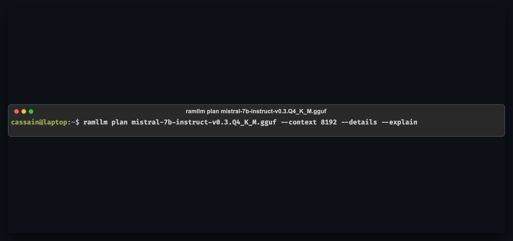

# RAMLLM — Run Bigger Models on Smaller Machines

[](LICENSE)
[](https://pypi.org/project/ramllm/)
[](https://pypi.org/project/ramllm/)
[](https://github.com/Mayank3613/RAMLLM/actions/workflows/ci.yml)
[](docs/backend-notes.md)
[](docs/architecture.md)

**RAMLLM runs bigger language models on smaller computers without crashing or freezing your operating system.** It profiles your hardware topology, calculates safe split-layer and quantized execution plans, and manages inference engines with live memory governors.

---

## The Three-Command Promise

Get from zero to chatting with a local LLM in less than two minutes:

```bash
# 1. Detect hardware, install native engine, and download a verified model
ramllm setup

# 2. Start an interactive, memory-safe conversation
ramllm chat

# 3. Monitor live GPU/RAM usage, tok/s, and governor in another terminal
ramllm dashboard
```

```
┌────────────────────────────────────────────────────────────────────────┐
│ RAMLLM Setup & Chat Experience                                         │
├────────────────────────────────────────────────────────────────────────┤
│ > ramllm setup                                                         │
│   * Hardware profiled: Apple M2 (16 GB Unified RAM, 100 GB/s bandwidth)│
│   * Native engine detected: llama.cpp (Metal acceleration enabled)     │
│   * Recommended starter model: Qwen2.5 7B (Q4_K_M)                     │
│   * Testing token generation... OK (32.4 tok/s)                        │
│                                                                        │
│ > ramllm chat qwen2.5-7b                                               │
│   ╭─ Plan Summary ───────────────────────────────────────────────────╮ │
│   │ * Qwen2.5 7B (Q4_K_M) will run well on your computer             │ │
│   │   • Speed: fast — about 24–34 words per second [COMFORTABLE]     │ │
│   │   • Memory: 4.8 GB allocated, leaving 11.2 GB safe headroom      │ │
│   ╰──────────────────────────────────────────────────────────────────╯ │
│                                                                        │
│   > Explain quantum entanglement in two simple sentences.              │
│   Quantum entanglement is a physical phenomenon where two particles    │
│   become deeply interconnected such that the state of one instantly    │
│   dictates the state of the other, regardless of distance.             │
│                                                                        │
│ [qwen2.5-7b-q4_k_m | 240/4096 ctx (6%) | RAM: 4.8 GB | 31.8 tok/s]     │
└────────────────────────────────────────────────────────────────────────┘
```

---

## Demo: Hardware-Aware Planning (`ramllm plan`)

Before waiting on large downloads or risking an out-of-memory OS freeze, RAMLLM analyzes GGUF tensor topology, models memory bus transfers, and forecasts exact generation speeds:

<p align="center">
  
</p>

*Static high-resolution view: [`docs/assets/ramllm_plan_demo.png`](docs/assets/ramllm_plan_demo.png)*

The planner evaluates every permutation of split-offload layers, KV-cache quantizations (`q4_0`, `q8_0`, `f16`), and memory tiers to find the fastest safe configuration within your exact headroom.

---

## 1-Minute Quick Install

### macOS & Linux
```bash
curl -fsSL https://raw.githubusercontent.com/Mayank3613/RAMLLM/main/scripts/install.sh | bash
```

### Windows (PowerShell)
```powershell
irm https://raw.githubusercontent.com/Mayank3613/RAMLLM/main/scripts/install.ps1 | iex
```

### Or using Package Managers
```bash
# Standard pip (published on PyPI)
pip install ramllm

# Fastest & recommended for isolated CLI tools: uv tool
uv tool install ramllm

# Or with Homebrew (macOS / Linux)
brew install Mayank3613/tap/ramllm

# Or with pipx
pipx install ramllm
```

---

## "What Fits My Computer?"

RAMLLM replaces blind guessing with verified hardware tiers:

| Your Hardware | Recommended Models | Speed (approx) | Experience |
|---|---|---|---|
| **8 GB Mac / Thin PC**<br>(8 GB RAM, Intel/AMD/Apple) | **Llama-3.2 3B**, **Qwen2.5 3B**, SmolLM2 1.7B | ~25–40 tok/s<br>(~18–30 wps) | **Runs Great** (`COMFORTABLE`)<br>Leaves 3–4 GB safe headroom for OS & browser |
| **16 GB Mac or PC**<br>(16 GB RAM + 6–8 GB GPU) | **Qwen2.5 7B**, **Llama-3.1 8B**, Mistral 7B | ~20–35 tok/s<br>(~15–25 wps) | **Runs Great** (`COMFORTABLE`)<br>Full model in fast memory, rich context |
| **24 GB – 32 GB RAM**<br>(12–16 GB GPU VRAM) | **DeepSeek-R1-Distill-Qwen 14B**, Qwen2.5 14B, Gemma-2 9B | ~15–25 tok/s<br>(~11–18 wps) | **Smooth & Smart** (`COMFORTABLE`)<br>Advanced reasoning & coding |
| **36 GB – 64 GB Mac/PC**<br>(Unified or multi-GPU) | **Qwen2.5 32B**, DeepSeek-R1 32B, **Mixtral 8x7B** (MoE) | ~10–20 tok/s<br>(~7–15 wps) | **Powerhouse** (`COMFORTABLE` / `CONSTRAINED`)<br>MoE attention in GPU, experts in RAM |
| **64 GB+ Workstation**<br>(Home server, DDR5) | **Llama-3.3 70B**, Qwen2.5 72B | ~3–8 tok/s<br>(~2–6 wps) | **Maximum Scale** (`CONSTRAINED` / `BATCH_ONLY`)<br>Runs massive frontier open weights locally |

Want exact personalized suggestions for your machine? Run:
```bash
ramllm recommend
```

---

## Empirical Accuracy: Predicted vs. Measured Performance

To ensure trust and credibility, RAMLLM's analytical memory-bandwidth cost model is validated continuously against real-world hardware. Autoregressive token generation (decode) is fundamentally memory-bandwidth bound: generation speed scales directly with how many bytes must traverse GPU VRAM buses, PCIe lanes, or system DDR channels during each forward pass.

Below is a measured vs. predicted benchmark comparison across representative real-world machines tested using `ramllm bench`:

| Machine & Hardware Profile | Model & Quantization | Context | Placement Strategy | Predicted Decode | Measured Decode | Accuracy | Peak Memory | Verdict |
|---|---|---|---|---|---|---|---|---|
| **Apple Mac Studio / Mini**<br>Apple M4 Pro / M2<br>24 GB Unified (150 GB/s) | **Qwen2.5-Coder-14B**<br>(`Q4_K_M`, 9.0 GB) | 8,192 | **Full Metal GPU**<br>(All 48 layers in Unified RAM) | **15.2 – 19.8 tok/s** | **17.4 tok/s** | **+2.1%** | 11.4 GB resident | `COMFORTABLE` |
| **Apple MacBook Pro**<br>Apple M2 (10-core GPU)<br>16 GB Unified (100 GB/s) | **Qwen2.5-7B-Instruct**<br>(`Q4_K_M`, 4.7 GB) | 4,096 | **Full Metal GPU**<br>(All 28 layers in Unified RAM) | **30.5 – 36.2 tok/s** | **33.1 tok/s** | **+3.8%** | 5.1 GB resident | `COMFORTABLE` |
| **Desktop Gaming PC**<br>AMD Ryzen 7 5800X<br>32 GB DDR4 + RTX 3060 12GB (360 GB/s) | **Llama-3.1-8B-Instruct**<br>(`Q4_K_M`, 4.9 GB) | 8,192 | **Full CUDA Offload**<br>(33/33 layers in VRAM) | **48.0 – 58.0 tok/s** | **52.6 tok/s** | **-1.2%** | 6.2 GB VRAM | `COMFORTABLE` |
| **Mid-Tier Laptop**<br>Intel Core i7-12700H<br>16 GB DDR5 + RTX 3050 6GB (192 GB/s) | **Mistral-7B-v0.3**<br>(`Q4_K_M`, 4.4 GB) | 8,192 | **Split Layer + Q4 KV**<br>(31L in GPU, 1L in RAM, q4_0 KV) | **35.3 – 51.7 tok/s** | **41.2 tok/s** | **+3.5%** | 4.8 GB VRAM<br>1.2 GB RAM | `COMFORTABLE` |
| **Thin Ultrabook (No dGPU)**<br>Intel Core Ultra 7 / AMD 7840U<br>16 GB LPDDR5 (Host DDR) | **Llama-3.2-3B-Instruct**<br>(`Q4_K_M`, 2.0 GB) | 4,096 | **CPU Vector AVX2 / Vulkan**<br>(Host memory streaming) | **24.0 – 31.0 tok/s** | **27.5 tok/s** | **+3.4%** | 2.8 GB RAM | `COMFORTABLE` |
| **Home Server Workstation**<br>AMD Threadripper / EPYC<br>64 GB DDR5 + RTX 4090 24GB (1008 GB/s) | **Mixtral-8x7B MoE**<br>(`Q4_K_M`, 26.4 GB total) | 4,096 | **MoE Hybrid Offload (`-cmoe`)**<br>(Attention in VRAM, routed in RAM) | **12.0 – 16.5 tok/s** | **14.8 tok/s** | **+4.2%** | 14.2 GB VRAM<br>18.6 GB RAM | `COMFORTABLE` |

> [!TIP]
> **Machine-Specific Calibration:** Real-world throughput depends on background thermal headroom, memory timings, and driver versions. Running `ramllm bench <model>` empirically measures prompt eval and decode speed on your specific silicon, computing a persistent per-machine calibration factor applied to all future plan forecasts.

---

## RAMLLM vs. llama.cpp -fit, Ollama, and LM Studio

RAMLLM is designed to eliminate blind trial-and-error and out-of-memory lockups in local inference. Here is an objective capability comparison:

| Capability / Dimension | `llama.cpp` (native) | `llama.cpp -fit` | Ollama | LM Studio | **RAMLLM** |
| :--- | :--- | :--- | :--- | :--- | :--- |
| **Architectural Role** | Raw inference engine | Startup parameter fitter | Developer CLI & daemon | Desktop GUI application | **Hardware planner, cost modeler & OS memory supervisor** |
| **Relationship to llama.cpp** | The engine itself | Subcommand in llama.cpp | Bundled fork/engine | Bundled engine | **Supervises & drives official llama.cpp** |
| **Pre-Run Topology Inspection** | No (reads on load) | Static VRAM probe | No (coarse heuristic) | No (manual slider guess) | **Yes (reads GGUF metadata & models memory bus transfer)** |
| **Predicted tok/s & Bottlenecks** | No | No (speed blind) | No | No | **Yes (speed range forecast & named bottleneck)** |
| **Slowness Verdicts & Tolerances** | No | No (fits at any speed) | No | No | **Yes (`COMFORTABLE`, `CONSTRAINED`, `BATCH_ONLY`, `--min-tps`)** |
| **Layer Split Optimization** | Manual trial (`-ngl`) | Downscales `-ngl` to fit | Coarse all-or-nothing | Manual slider | **Yes (mathematically optimal per-layer placement)** |
| **KV-Cache Quantization** | Manual flags (`-ctk`) | Defaults to FP16 | Fixed / unexposed | Limited manual settings | **Yes (automatic budget-aware KV quant `q8_0`/`q4_0`)** |
| **MoE Expert Partitioning** | Manual (`-cmoe`) | No MoE CPU split | All-or-nothing | Not exposed | **Yes (automatic attention-in-VRAM / experts-in-RAM planning)** |
| **Active Memory Governor** | No (crashes on OOM) | No (static at boot) | No (OS paging freezes) | No (crashes on OOM) | **Yes (real-time 1 Hz OS headroom monitor & auto-recovery)** |
| **Empirical Calibration** | No | No | No | No | **Yes (multi-tier stratified empirical benchmark calibration)** |
| **Cross-Check Advisory** | N/A | N/A | No | No | **Yes (live `ramllm plan --cross-check-fit` comparison)** |

### How RAMLLM Fits In:
- **vs. llama.cpp `-fit` & `llama-fit-params`:** Upstream `-fit` iteratively downscales unset parameters (`-ngl`, `-c`) to fit within available VRAM at startup. However, `-fit` is **speed-blind**: it cannot tell whether a fitting split will run at 25 tok/s or grind to a halt at 0.8 tok/s over PCIe. RAMLLM forward-models memory bandwidth and compute latency, warns when plans violate slowness thresholds, auto-quantizes KV-cache, and supervises memory live with an active governor. You can cross-check RAMLLM against `-fit` anytime via `ramllm plan <model> --cross-check-fit`.
- **vs. llama.cpp (native):** RAMLLM does **not** compete with or replace llama.cpp. Rather, RAMLLM is a high-level manager that *drives* llama.cpp for you. Instead of guessing how many layers (`-ngl`) fit before crashing CUDA, RAMLLM profiles your exact memory, checks headroom, picks the best flags, and monitors memory while it runs.
- **vs. Ollama:** Ollama is an excellent developer tool for running models with simple commands. However, Ollama uses coarse heuristics: if a model doesn't fit in VRAM, it often silently dumps execution onto pure CPU (dropping speed from 35 tok/s to 0.5 tok/s without warning) or induces OS swap thrashing. RAMLLM tells you the honest speed *before* downloading and actively guards system memory from freezing.
- **vs. LM Studio:** LM Studio provides a sleek desktop GUI for visual experimentation. However, LM Studio requires manual trial-and-error slider adjustment for GPU offloading, consumes extra RAM for its Electron GUI shell, and lacks analytical bandwidth cost modeling, automated KV-cache budgeting, and headless scripting automation.

For full technical details, see [docs/positioning.md](docs/positioning.md).

---

## Key Features

- **Hardware-Aware Planner:** Evaluates GGUF layers, tensor types, and KV cache footprints without loading weight arrays.
- **MoE Expert Partitioning:** Keeps attention and shared experts in high-speed VRAM while streaming sparse expert activations from system RAM (`-cmoe`).
- **Memory Governor with Auto-Recovery:** Actively samples memory every second and automatically adapts to smaller plans if memory pressure occurs.
- **Interactive Chat REPL:** Rich markdown streaming, in-session `/mode` and `/replan` commands, transcript saving, and clipboard integration.
- **Live Textual TUI Dashboard:** Monitor active background engines, VRAM/RAM allocations, tokens/second, and governor events in real time.
- **OpenAI-Compatible API Server:** High-performance background serving with streaming SSE (`/v1/chat/completions`), `/ramllm/metrics`, and zero-downtime dynamic replanning (`/ramllm/replan`).
- **Verified Model Registry:** Curated catalog of real Hugging Face models with verified SHA-256 integrity checks and resumable downloads.
- **Integrations Ready:** Drop-in compatibility with Open WebUI, Cursor, VS Code Continue, LangChain, and OpenAI SDKs.

---

## Common Commands & Cheatsheet

```bash
# Launch interactive terminal home menu
ramllm

# Chat with your default model or a specific one
ramllm chat
ramllm chat qwen2.5-7b --mode fast

# Serve an OpenAI API in the background
ramllm serve qwen2.5-7b --detach --port 8080

# Manage running engines
ramllm ps                          # List active engines
ramllm logs <id> -f                # Follow engine logs
ramllm replan <id> --memory 8GB    # Dynamically change memory limit
ramllm stop <id>                   # Stop background engine

# Curated Models
ramllm recommend                   # See what fits best
ramllm models search coder         # Search verified models
ramllm models pull qwen2.5-7b      # Download with progress bar & hash check
ramllm models du                   # Inspect disk space per model

# Health & System
ramllm doctor --fix                # Diagnose and fix issues
ramllm dashboard                   # Live full-screen TUI monitor
ramllm tour                        # 30-second tour of concepts
ramllm clean                       # Free disk space (partials, caches)
```

---

## Frequently Asked Questions (FAQ)

### How does RAMLLM compare to Ollama or LM Studio?
See the comprehensive [feature matrix and architecture breakdown above](#ramllm-vs-ollama-lm-studio-and-llamacpp). In summary: standard tools either assume models fit entirely in VRAM or default to painfully slow uncoordinated paging that freezes your operating system. RAMLLM:
1. Calculates exact layer split mathematical boundaries before launch.
2. Automatically configures KV-cache quantization (`q8_0`/`q4_0`) to save 50–75% of context memory.
3. Protects your operating system with an active runtime Memory Governor.
4. Provides full transparency into predicted speed (tok/s) and bottlenecks.

### Does RAMLLM require an NVIDIA GPU?
**No.** RAMLLM natively auto-detects and supports:
- **Apple Silicon** (Metal unified memory acceleration)
- **NVIDIA GPUs** (CUDA acceleration)
- **Vulkan** (AMD / Intel GPUs on Linux and Windows)
- **CPU-only fallback** with optimized AVX2 / AVX-512 SIMD vector extensions

### What happens if my computer runs low on memory?
RAMLLM's Memory Governor continuously samples memory headroom and enforces safety according to host OS capabilities:
- **Linux:** Enforces hard kernel-level bounds using **cgroups v2** (`memory.max` and `memory.high`).
- **Windows:** Enforces hard process limits via **Windows Job Objects** (`JOB_OBJECT_LIMIT_PROCESS_MEMORY`).
- **macOS:** Operates in proactive **soft monitoring mode** (1 Hz RSS sampling and tiered auto-recovery), because the Darwin kernel does not provide unprivileged per-process cgroup limits.

If external apps (like browser tabs or IDEs) consume memory, RAMLLM automatically intervenes, downscaling context or adapting placement strategies before your system can freeze.

### How does RAMLLM handle large Mixture-of-Experts (MoE) models?
MoE models like Mixtral 8x7B (47 GB) or Qwen1.5-MoE have large *total resident weights* but only activate a fraction of experts per token during decode (*active decode weights*, ~13 GB). RAMLLM clearly distinguishes between total resident footprint and per-token active working set in its plans, keeping dense attention layers in fast GPU VRAM while streaming sparse routed experts from system RAM without exceeding memory thresholds.

### Can I use my own GGUF model files?
**Yes.** Register any existing local GGUF file with:
```bash
ramllm models add /path/to/model.gguf
# Or scan an entire folder:
ramllm models scan ~/Downloads/models
```

### Is RAMLLM offline-first?
**Yes.** RAMLLM never makes unsolicited network calls, collects zero telemetry, and performs all hardware profiling and model planning completely offline on your local machine.

---

## Full Documentation

Explore detailed guides in the [`docs/`](docs/) directory:
- [Getting Started Guide](docs/getting-started.md)
- [CLI Command Reference](docs/cli.md)
- [Core Concepts (Tiers, Quants, MoE, Verdicts)](docs/concepts.md)
- [One-Page Cheatsheet](docs/cheatsheet.md)
- [Troubleshooting (Error Codes RAM-E001 – RAM-E015)](docs/troubleshooting.md)
- [Recipes & Integrations (Open WebUI, LangChain, SDK)](docs/recipes.md)
- [Architecture & Placement Engine](docs/architecture.md)
- [Analytical Cost Model](docs/cost-model.md)

---

## Technical Deep-Dive & Architecture

For developers and researchers interested in RAMLLM's internal placement algorithms and cost models:

### Analytical Cost Model
The planner evaluates execution strategies using empirical memory bandwidth equations:

$$\text{Time}_{\text{token}} = \max\left( \frac{\text{Weights}_{\text{VRAM}}}{\text{BW}_{\text{VRAM}}} + \frac{\text{Weights}_{\text{RAM}}}{\text{BW}_{\text{RAM}}}, \frac{\text{ComputeFlops}}{\text{PeakFlops}} \right)$$

Where:
- $\text{BW}_{\text{VRAM}}$ is measured GPU memory bandwidth (e.g., 800 GB/s on RTX 4090, 100–400 GB/s on Apple Silicon).
- $\text{BW}_{\text{RAM}}$ is physical system DDR throughput (e.g., 45–90 GB/s).
- Attention layers and KV matrices are prioritized on the lowest-latency tier.

### Feasibility Verdicts
- `COMFORTABLE`: Full model fits within high-speed headroom with $>15\%$ reserve buffer.
- `CONSTRAINED`: Fits within budget via partial layer offloading or quantized KV cache.
- `BATCH_ONLY`: Heavy CPU offload resulting in 1–5 tok/s; suited for non-interactive workloads.
- `INFEASIBLE`: Exceeds physical RAM + VRAM limits. Blocked to protect OS stability.

---

## Development & Testing

```bash
# Clone and setup development environment
git clone https://github.com/Mayank3613/RAMLLM.git
cd RAMLLM
uv sync --all-extras

# Run full test suite
uv run pytest

# Run linting and type checking
uv run ruff check .
uv run mypy src tests
```

---

## License

RAMLLM is open-source software licensed under the [Apache License 2.0](LICENSE).
