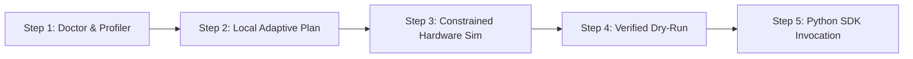

# Interactive Demo & Terminal Recording Guide

RAMLLM includes a self-contained demonstration script, [`scripts/demo.sh`](../scripts/demo.sh), designed to showcase RAMLLM's memory-adaptive planning, hardware profiling, cross-hardware simulation, and programmatic SDK integration without requiring multi-gigabyte model downloads or GPU hardware.

---

## Quick Start

You can run the demonstration directly from the repository root:

```bash
# Interactive mode (press Enter to proceed through each step)
./scripts/demo.sh

# Non-interactive mode (ideal for automated recordings and CI)
./scripts/demo.sh --non-interactive --delay 1.0
```

### Options

| Flag | Description | Default |
| :--- | :--- | :--- |
| `--non-interactive`, `-y` | Run through all demo steps without pausing for user input | `false` |
| `--delay <seconds>`, `-d` | Pause duration between steps when in non-interactive mode | `1.5` |
| `--help`, `-h` | Display usage instructions | - |

---

## Demonstration Workflow

The demonstration walks through five key capabilities of RAMLLM:



### 1. Hardware Diagnostic & OS Enforcement (`ramllm doctor`)
Probes the host machine's hardware environment:
- Physical and logical CPU core counts, SIMD instruction sets (AVX-512, NEON, AMX).
- System RAM and available memory margin.
- GPU availability and VRAM budgets.
- OS-level memory governor enforcement mechanism (e.g. Linux `cgroups v2`, macOS soft polling, or Windows Job Objects).

### 2. Adaptive Planning on Host Hardware (`ramllm plan`)
Demonstrates analytical multi-tier placement:
- Parses tensor layout and metadata from a synthetic GGUF model (<5 MB).
- Generates ranked execution plans balancing VRAM peak, RAM peak, and predicted decode tokens/sec.
- Evaluates speed bottlenecks (e.g. `vram_bw`, `ram_bw`, or `compute`).

### 3. Cross-Hardware Simulation (`--hw-json`)
Simulates execution on a foreign hardware profile (e.g. an 8 GB RAM laptop with no discrete GPU):
- Demonstrates how RAMLLM automatically computes CPU layer placement.
- Applies the Flash Attention V-cache rule (downgrading quantized V-cache to f16 when running CPU-bound KV).
- Adjusts predicted throughput based on host memory bandwidth models.

### 4. Verified Dry-Run Engine Launch (`ramllm run --dry-run`)
Validates engine command line parameters (`-ngl`, `-c`, `-ub`, `--fit` cross-check) without launching the backend process or reserving system memory.

### 5. Programmatic Python SDK Usage
Executes a Python snippet importing official public symbols:
```python
from ramllm import UserRequest, analyze_gguf, create_execution_plans, probe_hardware

hw = probe_hardware()
model = analyze_gguf("tests/fixtures/models/synthetic_tiny.gguf")
plans = create_execution_plans(model, hw, UserRequest(model=str(model.path)))
print(f"Top Plan: {plans[0].verdict} ({plans[0].speed.bottleneck})")
```

---

## Recording Terminal Demos

To create polished GIF or SVG terminal animations for documentation, project presentations, or social media, use either **asciinema** or **Charm VHS**.

### Option A: Using `asciinema` + `agg`

1. **Install asciinema and agg:**
   ```bash
   # macOS
   brew install asciinema agg

   # Linux
   sudo apt install asciinema
   cargo install --git https://github.com/asciinema/agg
   ```

2. **Record the session:**
   ```bash
   asciinema rec demo.cast -c "./scripts/demo.sh --non-interactive --delay 1.2"
   ```

3. **Render to high-quality animated GIF:**
   ```bash
   agg --font-family "JetBrains Mono" --theme monokai --font-size 16 demo.cast docs/assets/demo.gif
   ```

---

### Option B: Using Charm VHS

[Charm VHS](https://github.com/charmbracelet/vhs) produces reproducible, pixel-perfect terminal GIFs from a declarative `.tape` file.

1. **Install VHS:**
   ```bash
   brew install charmbracelet/vhs/vhs
   ```

2. **Create `demo.tape`:**
   ```text
   # Output configuration
   Output docs/assets/demo.gif
   Set FontSize 15
   Set FontFamily "JetBrains Mono"
   Set Width 1200
   Set Height 720
   Set Padding 20
   Set Theme "Catppuccin Mocha"

   # Launch demo
   Type "./scripts/demo.sh"
   Enter
   Sleep 2.5s

   # Step 1: Doctor
   Enter
   Sleep 3.5s

   # Step 2: Planning
   Enter
   Sleep 4.0s

   # Step 3: Hardware Simulation
   Enter
   Sleep 4.0s

   # Step 4: Dry Run
   Enter
   Sleep 3.0s

   # Step 5: Python API
   Enter
   Sleep 4.0s

   # Hold final screen
   Sleep 5.0s
   ```

3. **Generate the GIF:**
   ```bash
   vhs demo.tape
   ```

---

## Troubleshooting & Tips

- **UTF-8 Box Drawing Glyphs:** Ensure your terminal emulator is configured with a modern Unicode-capable font (e.g. JetBrains Mono, Fira Code, SF Mono) to render Rich tables and status glyphs (`✔`, `!`, `╭─╮`) properly.
- **Fixture Generation:** The script automatically generates `tests/fixtures/models/synthetic_tiny.gguf` using `scripts/create_fixture_gguf.py` if missing. You can regenerate it manually at any time:
  ```bash
  python3 scripts/create_fixture_gguf.py --output tests/fixtures/models/synthetic_tiny.gguf
  ```
